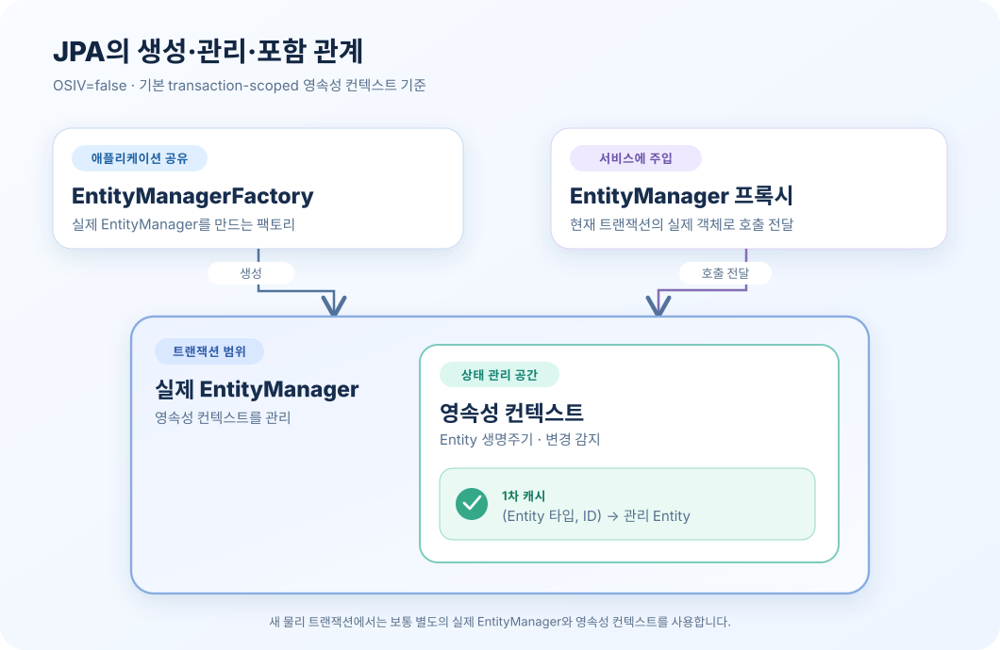
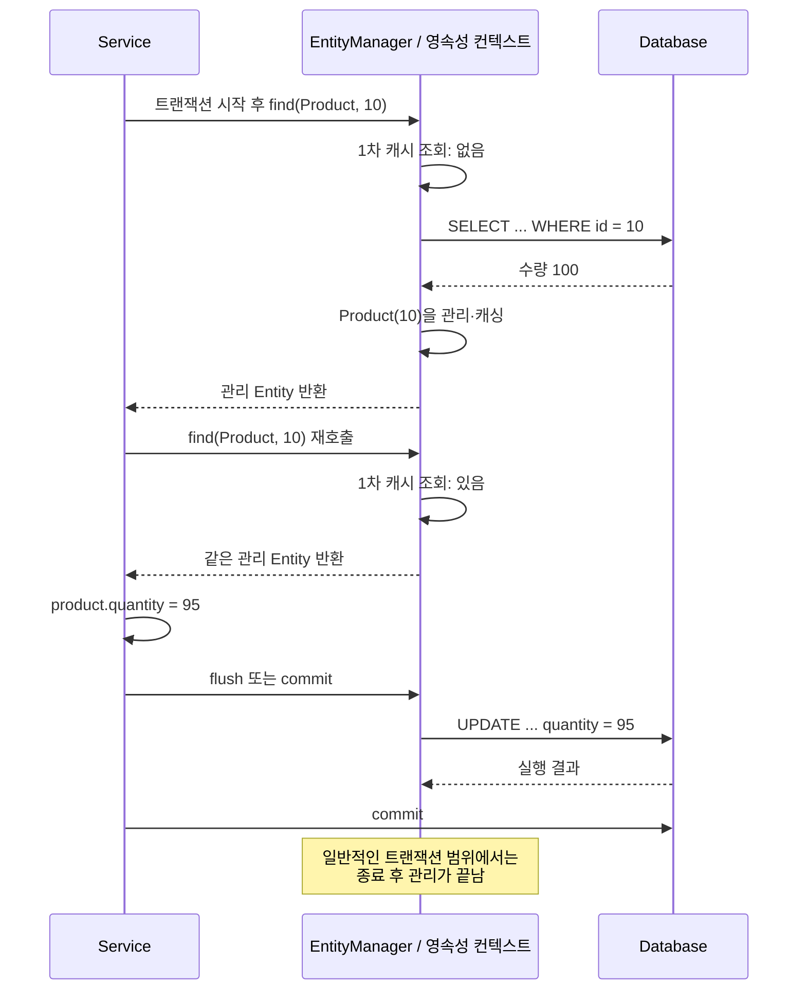
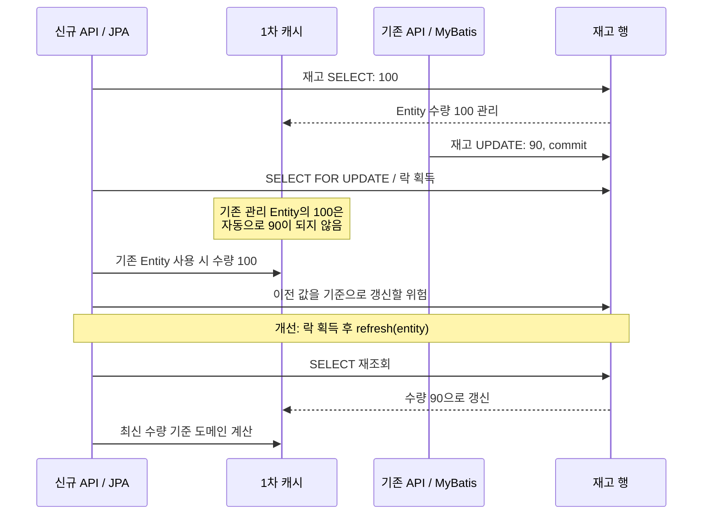

# 재고 정합성 01: JPA 영속성 컨텍스트

## 이번 단원의 목표

MyBatis와 JPA가 같은 재고를 갱신한 상황을 시퀀스로 설명하고 `refresh()` 선택과 검증 근거까지 방어한다.

## 개념 설명과 흐름 그림

### 먼저 구분할 것

- **EntityManager**: Entity를 조회·저장·삭제하는 JPA API의 중심 객체.
- **영속성 컨텍스트**: EntityManager가 관리하는 Entity와 그 상태를 추적하는 공간. 변경 감지·동일성 보장·쓰기 지연을 관리한다.
- **1차 캐시**: 영속성 컨텍스트 안에서 `(Entity 타입, 식별자)`를 키로 관리 Entity를 찾는 저장소. 애플리케이션 전체가 공유하는 캐시가 아니다.
- **트랜잭션**: DB 작업을 하나의 원자적 작업으로 묶는 경계. 영속성 컨텍스트의 생성·종료 시점과 항상 같지는 않다. Spring의 일반적인 트랜잭션 범위 EntityManager에서는 대체로 트랜잭션과 함께 사용·종료되지만, Open EntityManager in View나 확장 영속성 컨텍스트에서는 더 오래 유지될 수 있다.

**정정할 점:** 트랜잭션이 시작될 때 DB의 모든 데이터가 1차 캐시에 저장되는 것은 아니다. `find()` 같은 조회로 Entity가 로딩되거나 `persist()`로 관리 대상이 될 때 해당 Entity가 들어간다.

### EntityManagerFactory → EntityManager → 영속성 컨텍스트

#### 포함·관리 관계

Spring이 서비스에 주입한 `EntityManager` 프록시는 위의 실제 `EntityManager`로 호출을 연결한다.

**OSIV=false, 기본 transaction-scoped `@PersistenceContext` 기준:** `EntityManagerFactory`는 여러 `EntityManager`를 생성하는 팩토리다.

Spring이 서비스에 주입하는 것은 보통 공유 `EntityManager` **프록시**이며, 이 프록시는 현재 트랜잭션에 연결된 실제 `EntityManager`로 호출을 전달한다. `JpaTransactionManager`가 새 트랜잭션을 시작할 때 사용할 실제 `EntityManager`를 생성·바인딩하고, 그 `EntityManager`가 영속성 컨텍스트를 관리한다.

그 안에 1차 캐시가 있다. 커밋 또는 롤백과 정리가 끝나면 해당 실제 `EntityManager`는 닫히고 관리 Entity는 detached 상태가 된다. 주입된 프록시 자체는 계속 남아 다음 트랜잭션의 `EntityManager`를 가리킨다.

따라서 **새 물리 트랜잭션마다 별도 영속성 컨텍스트**라고 이해하면 된다. 단, `REQUIRED`로 기존 트랜잭션에 참여하는 메서드는 같은 컨텍스트를 공유한다. `REQUIRES_NEW`는 기존 트랜잭션을 잠시 중단하고 별도 컨텍스트를 사용한다.

트랜잭션 밖에서 프록시를 호출하는 경우 Spring이 작업용 `EntityManager`를 일시적으로 생성할 수 있으므로 “영속성 컨텍스트는 오직 트랜잭션 안에서만 생긴다”는 표현은 피한다. `EXTENDED` 영속성 컨텍스트도 별도 예외다.

### 생명주기 그림

### SQL은 정확히 언제 나가는가?

**flush가 일어나는 대표 시점:**
- 트랜잭션 commit 직전
- `EntityManager.flush()`를 직접 호출할 때
- `FlushMode.AUTO`에서 쿼리 결과와 변경 내용의 일관성을 맞춰야 할 때 쿼리 실행 전이다.

쿼리 전 flush의 정확한 판단은 JPA 구현체와 쿼리 종류에 따라 달라진다. `FlushMode.COMMIT`은 쿼리 전 자동 flush를 줄일 수 있지만 쿼리에서 미반영 변경이 보이는지는 보장하지 않는다. `flush`는 DB에 SQL을 보내는 것이며 **commit은 아니다**. 이후 rollback하면 그 SQL의 변경도 취소된다.

| 동작 | 1차 캐시/관리 상태 | 일반적인 SQL 시점 |
| --- | --- | --- |
| `find()` 첫 조회 | 없으면 DB 결과를 관리·캐싱 | 캐시 미스 때 SELECT |
| `find()` 재조회 | 같은 관리 Entity 반환 | 보통 SELECT 없음 |
| `persist()` | 새 Entity가 관리 대상이 됨 | 보통 flush 때 INSERT. `IDENTITY` 키 생성은 식별자를 얻으려고 즉시 INSERT할 수 있음 |
| 관리 Entity 필드 변경 | 변경 감지 대상 | flush 때 UPDATE. 실제 변경 여부와 SQL은 매핑·설정의 영향도 받음 |
| `remove()` | 삭제 예정 상태 | flush 때 DELETE |
| JPQL/QueryDSL 조회 | 쿼리 결과 Entity가 관리 대상이 될 수 있음 | 쿼리 실행 때 SELECT. FlushMode AUTO에서는 쿼리 전 flush가 일어날 수 있음 |
| `flush()` | 변경을 DB에 동기화하고 캐시는 유지 | 대기 중인 INSERT/UPDATE/DELETE 실행. commit은 아님 |
| `refresh(entity)` | DB 값으로 관리 Entity를 덮어씀 | SELECT 재실행. 미반영 변경 유실에 주의 |
| `clear()` | 관리 Entity를 모두 분리 | 자체로 SQL 없음. 미반영 변경은 사라질 수 있어 필요 시 먼저 flush |
| `commit` | 일반적으로 선행 flush 후 DB 확정 | SQL 실행 및 COMMIT |
| `rollback` | DB 변경 취소 | ROLLBACK. 이후 같은 Entity 상태를 신뢰하지 말고 컨텍스트를 정리해야 함 |

Spring의 트랜잭션 범위에서 commit이 끝나면 해당 범위의 EntityManager가 닫히고 Entity는 더 이상 관리되지 않는다. 다만 OSIV가 켜져 있으면 웹 요청 끝까지 EntityManager가 열려 있을 수 있으므로 실제 설정을 확인해야 한다. 트랜잭션 종료와 1차 캐시 제거를 무조건 동일시하면 안 된다.

### 재고 사고에 대입한 그림

비관적 락은 **다른 트랜잭션의 동시 변경 순서**를 제어한다. 이미 메모리에 있는 JPA Entity를 최신 값으로 바꿔 주는 기능과는 별개다. 실제 프로젝트에서 `SELECT FOR UPDATE`가 어떤 Entity를 반환했고 어떤 시점에 락을 잡았는지는 SQL 로그·코드로 설명해야 한다.

### 실제 사례: 왜 `refresh()`였는가?

| 선택지 | 장점 | 비용·한계 |
| --- | --- | --- |
| 처음부터 락 조회 | 오래된 Entity 로딩을 줄임 | 모든 조회 경로와 순서를 통제해야 하고 락 보유 시간이 늘 수 있음 |
| 락 후 `refresh()` | 기존 도메인 계산과 트랜잭션 구조를 유지하며 최신 DB 값 반영 | 추가 SELECT, flush되지 않은 변경 덮어쓰기, 모든 변경 경로에 일관 적용 필요 |
| 원자적 조건부 UPDATE | DB가 조건 검사와 갱신을 한 번에 수행 | 복잡한 도메인 검증과 관리 Entity 동기화 방식 재설계 필요 |
| `@Version` 낙관적 락 | 충돌을 감지하고 락 대기를 줄일 수 있음 | MyBatis와 JPA 양쪽에서 버전 규칙·재시도 정책을 지켜야 함 |

포트폴리오상 선택은 **재고별 ID 순서 락 → `refresh()` → 도메인 계산 → 이력 Batch INSERT**다. 669개 상품 요청에서 반복 DB 작업을 줄였다고 적혀 있다. Level 5 답변에는 재현 시나리오, 동시 요청 테스트, 복구 대사, 6개월 관측 기준, p95 표본을 추가로 확인해 넣어야 한다.

### 2026-11-18 실제 답변에서 확인한 맥락

- **선조회 경로:** 패킹존 스캔 API에서 `EntityGraph`를 통해 재고 Entity가 먼저 관리 대상이 되었다고 본인이 설명했다.
- **충돌 순서:** Tx1의 선조회 뒤 Tx2의 MyBatis 재고 변경이 확정되고, Tx1이 행 락을 얻어도 기존 관리 Entity의 수량을 사용해 차감분을 되돌리는 상황이 발생했다고 설명했다. 실제 락 SQL과 commit 순서는 코드·로그로 재확인한다.
- **적용:** 관리 Entity를 다시 읽을 때 `refresh(entity, LockModeType.PESSIMISTIC_WRITE)`로 비관적 쓰기 락을 함께 지정했다.
- **복구·관측:** 변경 히스토리로 대상 재고를 찾아 재고조정 기능으로 복구했다. 이후 6개월 동안 정상 변경 패턴을 벗어난 이력이 있는지 주간 단위로 확인했다. 면접 본문에서는 컬럼명을 나열할 필요 없이 검증 원리·주기·관측 결과를 말한다. 구체적 판정 방식은 추가 질문에 대비한다.
- **성능 수치의 조건:** p95 2,733ms→141ms는 같은 API의 배포 전 7일·배포 후 7일을 비교한 값이라고 본인이 정정했다. 669개가량의 상품을 포함하는 큰 요청을 기준으로 설명했지만 양쪽 기간의 요청별 상품 수 분포와 표본 수가 같았는지는 확인되지 않았다. 따라서 `동일 API의 전후 운영 관측값`이라고 표현하고, 완전히 동일한 부하·요청 조건의 실험이라고 말하지 않는다.
- **대안 표현 정정:** 원인은 낙관적 락 실패가 아니다. 낙관적 락은 고려 가능한 대안이지만 MyBatis와 JPA 양쪽이 같은 버전 규칙을 지키고 충돌·재시도를 처리해야 해 당시 변경 범위가 컸다. `EntityGraph` 선조회 자체가 문제라기보다 락 전에 로딩된 Entity를 최신화하지 않고 쓴 것이 문제다.

## Level 1 — 정의

**질문:** 영속성 컨텍스트와 1차 캐시는 무엇인가? 같은 식별자로 `find()`를 두 번 호출하면 무엇이 반환되는가?

**답변 핵심:** 영속성 컨텍스트는 Entity의 생명주기와 변경 감지를 관리하는 범위다. 1차 캐시는 식별자별 관리 Entity를 보관하며 같은 컨텍스트에서 같은 식별자를 조회하면 같은 관리 객체가 반환될 수 있다. 컨텍스트 범위와 `clear()`·`detach()`의 효과를 함께 설명한다.

## Level 2 — 내부 동작

**질문:** 변경 감지는 언제 SQL을 내보내며, `flush()`·commit·`refresh()`는 각각 무엇을 하는가?

**답변 핵심:** 변경 감지는 관리 Entity의 변경을 flush 시점에 SQL로 동기화한다. flush는 commit과 같지 않다.

`refresh()`는 DB 상태를 다시 읽어 관리 Entity에 반영하므로 미반영 변경을 덮을 수 있다. 실제 SQL 실행 시점은 ID 생성 전략과 쿼리 실행 등에도 영향을 받는다.

## Level 3 — 장애·한계

**질문:** MyBatis가 DB를 수정했는데 JPA Entity의 수량이 이전 값일 수 있는 이유는? `SELECT FOR UPDATE`만으로 해결되지 않은 이유는?

**답변 핵심:** MyBatis 갱신은 이미 로딩된 JPA 관리 Entity를 자동 갱신하지 않는다. 락은 동시 변경을 제어하지만 캐시된 객체의 필드를 자동으로 최신화하지 않는다.

재고 Entity의 선조회→다른 트랜잭션 변경→락 획득→이전 Entity 사용 순서로 설명한다. DB 격리 수준, 커넥션과 트랜잭션의 실제 순서는 코드와 로그로 확인한다.

## Level 4 — 대안·Trade-off

**질문:** 최초 조회부터 락, `refresh()`, optimistic lock, 원자적 UPDATE, 전면 JPA 전환 중 왜 해당 방식을 택했는가?

**답변 핵심:** 당시에는 기존 트랜잭션과 도메인 검증을 유지하며 락 이후 최신 수량을 확보하는 `refresh()`를 선택했다. 원자적 UPDATE는 조건식과 영향 행 수로 충돌을 판단할 수 있지만 도메인 규칙·영속성 컨텍스트 관리 변경이 필요했다.

optimistic lock은 MyBatis/JPA 양쪽의 버전 계약과 재시도 정책이 필요하다. 각 대안의 유지 비용과 실패 형태를 말한다.

## Level 5 — 실제 적용·검증

**질문:** 어떤 코드 경로에서 Entity가 먼저 로딩됐는가? 락과 `refresh()`의 정확한 순서는? 수량 복구와 6개월 관측은 어떤 데이터 대사로 검증했는가? p95 2,733→141ms는 동일 조건인가?

**답변 구성:** 상황(중복 변경 경로와 피해 범위) → 본인 역할 → 재현 시퀀스 → 선택·구현 → 동시성 테스트와 운영 대사 → 전후 수치의 조건 → 남은 한계.

**현재 확인 상태:** PDF에는 구현 흐름과 결과 수치가 있다. 코드 위치, 재현 테스트, 대사 쿼리·주기·대상, APM 필터·표본 수는 아직 확인하지 못했다. 면접 답변에서는 이를 확인 전 사실로 단정하지 않는다.

## 첫 구술 연습

1. 자료를 보지 않고 Level 1~3을 각각 60초로 답한다.
2. Level 4를 90초로 답하며 네 가지 대안을 비교한다.
3. Level 5를 2분으로 답하고 확인되지 않은 수치는 `확인 필요`라고 말한다.
4. 답변과 근거를 `03_학습_기록.md`에 기록한 뒤 다음 단원으로 넘어간다.
