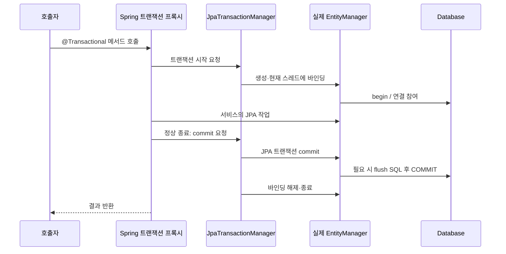
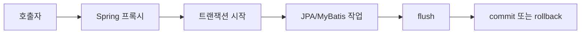
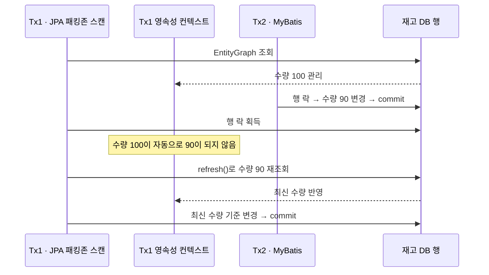

# 02. Spring 트랜잭션과 MyBatis·JPA 혼용

## 기술 개념 전체 설명

### 트랜잭션 경계

트랜잭션은 여러 DB 변경을 하나의 확정 또는 취소 단위로 묶는다. Spring의 @Transactional은 보통 프록시가 메서드 진입·종료에서 begin, commit, rollback을 제어한다. 같은 객체 내부 호출은 프록시를 거치지 않을 수 있다.

트랜잭션은 **어떤 작업들이 함께 성공하거나 함께 실패할지**를 정한다. ACID는 다음 네 가지 속성을 뜻한다.

- **원자성**은 모든 변경을 함께 확정하거나 취소한다는 뜻이다.
- **일관성**은 트랜잭션 결과가 정의된 제약을 만족한다는 뜻이다.
- **격리성**은 동시 트랜잭션의 변경 가시성과 간섭을 제어한다.
- **지속성**은 커밋한 결과를 장애 뒤에도 유지한다는 뜻이다.

재고 음수 방지처럼 애플리케이션에서 정의하고 검사해야 하는 업무 규칙도 있다.

`@Transactional`은 보통 Spring 프록시를 통과할 때 적용된다. 프록시는 트랜잭션 매니저에 시작을 요청한다. 메서드가 정상 종료되면 commit을 요청한다. 롤백 대상 예외가 밖으로 나오면 rollback을 요청한다.

JPA는 commit 과정에서 필요한 변경을 flush할 수 있다.



실제 `EntityManager`는 새 물리 트랜잭션에 연결된다. `@PersistenceContext`로 주입한 공유 프록시는 현재 트랜잭션의 실제 `EntityManager`에 호출을 전달한다. 같은 물리 트랜잭션이면 영속성 컨텍스트도 공유한다.

### 전파와 롤백

REQUIRED는 기존 트랜잭션에 참여하고 REQUIRES_NEW는 독립 트랜잭션을 만든다. 기본적으로 RuntimeException과 Error에서 롤백하지만 checked exception은 설정을 확인해야 한다.

독립 트랜잭션은 추가 커넥션 점유와 외부 트랜잭션과의 확정 시점 차이를 만든다.

| 전파 옵션 | 외부 트랜잭션이 있을 때 | 주요 결과 |
| --- | --- | --- |
| `REQUIRED` | 같은 물리 트랜잭션에 참여 | 내부 작업만 별도로 commit할 수 없음. 내부에서 rollback-only가 되면 외부 commit도 실패할 수 있음 |
| `REQUIRES_NEW` | 외부 트랜잭션·자원을 잠시 중단하고 새 물리 트랜잭션 시작 | 별도 실제 EntityManager·영속성 컨텍스트 사용. 내부가 먼저 commit돼도 외부는 나중에 rollback될 수 있음 |

```text
외부 REQUIRED:       ├──────────── EM A / TX A ────────────┤
내부 REQUIRES_NEW:           ├── EM B / TX B ──┤
                             B commit         A rollback 가능
```

기본 롤백 규칙은 `RuntimeException`과 `Error` 중심이다. checked exception에서도 롤백하려면 `rollbackFor` 등 설정이 필요할 수 있다.

예외를 메서드 안에서 잡아 정상 반환하면 프록시는 실패를 알지 못하므로 그대로 commit할 수 있다. 프록시를 거치지 않는 같은 객체 내부 호출도 새 `@Transactional` 설정이 적용되지 않을 수 있다.

### 혼용 시 조건

MyBatis와 JPA가 같은 물리 트랜잭션·DataSource·커넥션에 참여하는지 확인해야 한다. MyBatis의 SQL 실행은 JPA 영속성 컨텍스트의 관리 Entity를 자동 갱신하지 않는다. flush 시점과 MyBatis 실행 순서도 결과에 영향을 준다.

Spring 관리 `SqlSessionTemplate`과 JPA가 같은 DataSource 및 호환되는 트랜잭션 설정을 사용하면 같은 DB 트랜잭션에 참여하도록 구성할 수 있다. **같은 서비스 메서드에서 호출했다는 이유만으로 같은 트랜잭션이라고 단정하지 않는다.** 트랜잭션 매니저·DataSource·실제 커넥션을 확인한다.

같은 트랜잭션 안에서 실행되더라도 상태 저장소는 다르다. MyBatis는 SQL을 직접 실행한다.

JPA는 영속성 컨텍스트의 Entity를 추적한다. MyBatis가 같은 행을 수정해도 이미 로딩한 JPA Entity는 자동 갱신되지 않는다.

MyBatis 호출 전에는 JPA 변경을 `flush()`해야 하는지 확인한다. MyBatis로 변경한 뒤에는 JPA에서 `refresh()`나 재조회가 필요한지 확인한다.

## 흐름 그림



## 이력서·포트폴리오 사례 연결

재고 수량 갱신과 이력 저장이 같은 원자적 경계에 있었는지, MyBatis 갱신이 JPA 캐시와 언제 어긋났는지 코드·SQL 로그로 확인한다.

이 사례는 **서로 다른 트랜잭션의 순서**와 **한 트랜잭션 안의 관리 Entity 상태**를 함께 봐야 한다.



비관적 락은 유지하고 락 직후 `refresh()`한 이유를 설명한다. 수량 변경과 이력 저장의 원자적 범위, 실패 시 롤백, 커넥션 사용 방식은 실제 코드·설정으로 검증할 항목이다.

## Level 1~5 문제

### Level 1 · 정의

트랜잭션의 ACID와 Spring @Transactional은 무엇인가?

### Level 2 · 내부 동작

프록시는 언제 begin/flush/commit/rollback을 실행하는가?

### Level 3 · 장애·한계

같은 클래스 내부 호출과 checked exception에서 예상과 다른 결과가 나는 이유는?

### Level 4 · 대안과 Trade-off

REQUIRED와 REQUIRES_NEW, 단일 트랜잭션과 분리 트랜잭션의 비용은?

### Level 5 · 실제 적용과 검증

재고 변경·이력 저장의 실제 트랜잭션 경계와 실패 시 복구 테스트를 보여 달라.

## 학습 기록

- 상태: Level 1~5 통과. `REQUIRES_NEW`의 커넥션 비용과 내부 예외 전파를 구분해 설명함.
- 재현 방식: 두 API의 처리 지점에 `Thread.sleep()`을 넣어 실행 순서를 조절했다고 본인이 설명했다.
- 개념 보완: 격리 수준에 따라 동시 트랜잭션이 볼 수 있는 데이터가 달라진다. `REQUIRES_NEW`의 롤백 상태는 독립적이며, 예외가 바깥으로 전달되면 바깥 트랜잭션에도 자체 롤백 규칙이 적용된다.
- 사례 보완: Tx2 커밋 후 Tx1이 락을 얻고 최종 재고 필드 대신 다른 필드를 수정했다. Hibernate의 기본 UPDATE는 수정 가능한 다른 매핑 컬럼도 포함할 수 있다. 최종 재고 컬럼이 실제 SET 절에 포함됐는지는 SQL 확인이 필요하다. 적용 후 최종 재고는 재고 차감 이력과 대조했다.
- 별도 검증: 이력 저장에 실패했을 때 수량도 함께 롤백되는지 검증한 기록은 미확인이다. 동시 실행 재현과 이미 커밋된 불일치의 재고조정 복구는 별도로 설명한다.
- [상세 학습 기록](03_학습_기록.md)
